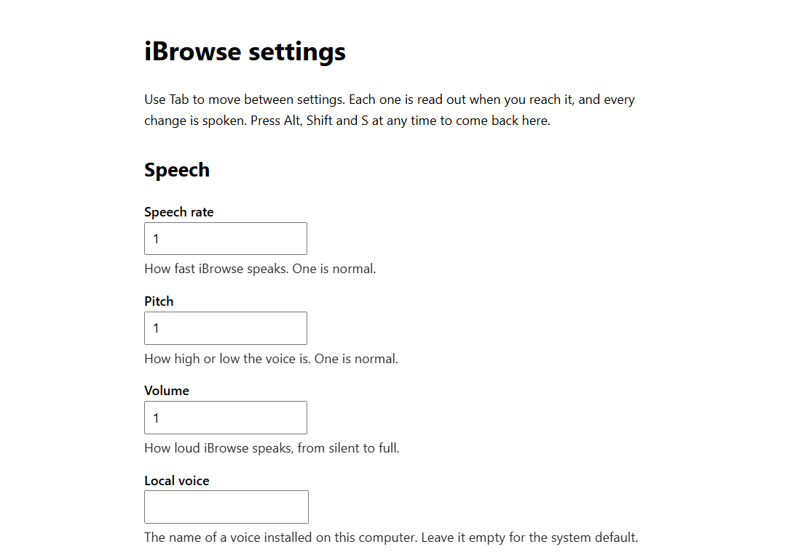
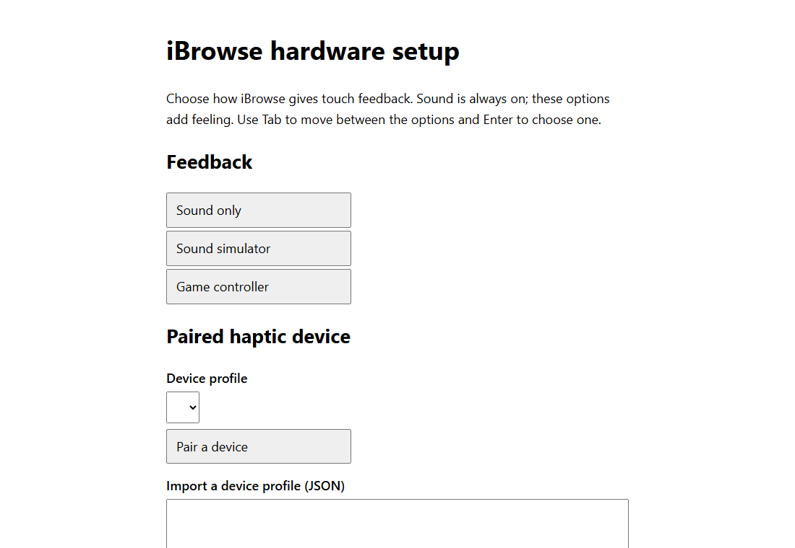
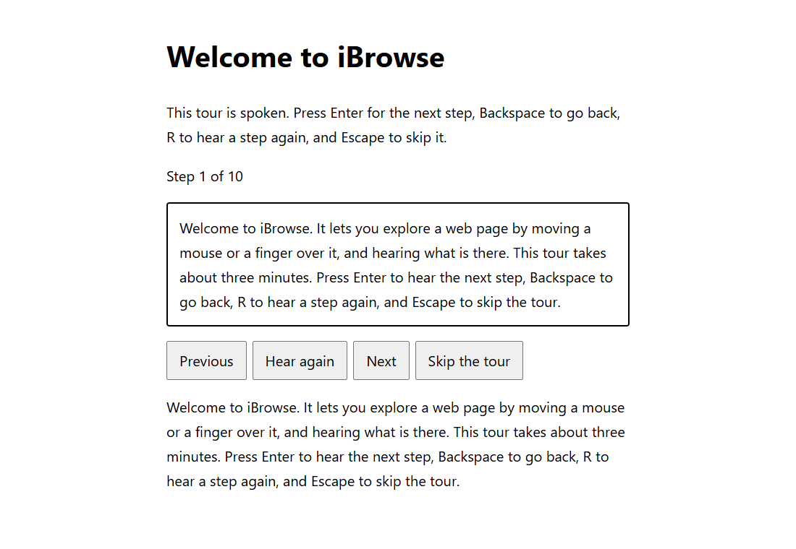

# iBrowse

**Explore and operate any website by sound, touch and haptics, without needing to see it.**


iBrowse is a Chrome extension for blind and low-vision people. Turn on **Explore Mode** and it briefs you on the page ("Picture on the left, hero section, 34 paragraphs. Want me to read it?"). Glide a mouse or a finger and hear what is under it. Click a paragraph to hear it read, scrub it word by word with the scroll wheel, and move to the next page with one gesture. Haptic hardware plugs in through an open SDK, and audio alone is a complete experience.

> **Pre-release.** All six build phases are complete and automatically tested, but iBrowse has not yet been checked on real haptic hardware, with a real Gemini key, or with NVDA or VoiceOver, and is not on the Chrome Web Store. See [Status](#status).

## Screenshots

Every page of iBrowse works by keyboard and is spoken aloud. These are the pages you can see.

| Settings | Hardware setup | First-run tour |
|---|---|---|
|  |  |  |

## Who it is for

| You are… | iBrowse gives you… |
|---|---|
| **Blind, using a screen reader** | A spatial way to explore layout (where things are), beside your screen reader through Companion mode. |
| **Blind, with no screen reader** | A complete standalone voice. Install, tour, settings and hardware setup all speak. |
| **Low vision** | Audio descriptions of what is under the pointer, plus a briefing of the whole page. |
| **A haptic or accessibility hardware maker** | An open [SDK](sdk/README.md): describe a device in JSON, or contribute a driver. |
| **An accessibility researcher or teacher** | An open, tested reference for hover, touch and haptic page exploration. |
| **A developer** | A well-documented MV3 codebase with decisions recorded as ADRs. |

It is **not** a replacement for a full screen reader, and is not a medical or safety device. See the [usage policy](USAGE_POLICY.md).

## Features

- **Page briefing.** A spoken summary of layout and content on request, ending in "Want me to read it?"
- **Spatial exploration.** Hover, touch or glide to hear what is under you: `Save, button, Clickable` or `Text only`. Sure and Maybe clickability are told apart.
- **Reading.** Click a paragraph to read it. Step through words with the wheel; Shift+wheel spells a word.
- **Navigation.** Next and previous page (keys, side mouse buttons or right-click menu); jump by heading or landmark.
- **Forms and live changes.** Spoken field names, typing echo (passwords never spoken), validation messages, dialogs and live updates.
- **Touch.** Drag to explore, double-tap to activate, edge cues.
- **Sound placement.** Earcons panned left and right by where the pointer is.
- **Haptics.** Eight tactile events through a sound simulator, a rumbling game controller, or a USB device you describe in JSON.
- **Screen reader mode (Companion).** Speech goes through a live region so your screen reader speaks once.
- **Optional Google Gemini** voice and AI (describe an image, summarise a page) with your own key. Off until you allow it.
- **Private by default.** No account, no analytics, no servers. See [PRIVACY.md](PRIVACY.md).

## Install

iBrowse is not on the Chrome Web Store yet. To try it:

```
git clone <this repository>
cd ibrowse
npm install
npm run build
```

Then open `chrome://extensions`, turn on **Developer mode**, choose **Load unpacked**, and select `.output/chrome-mv3`. A spoken tour opens on install.

## Quick start

1. Press **Alt+Shift+E** on a page, or click the iBrowse toolbar button, to turn on Explore Mode.
2. Listen to the briefing. Press **Y** to have it read, or **N** to skip.
3. Move the mouse, or drag a finger, to hear what is under it. Click a paragraph to read it.
4. Press **Alt+Shift+S** for settings and **Alt+Shift+P** for hardware.

## Keyboard and mouse

| Do this | Keys |
|---|---|
| Turn Explore Mode on or off | Alt+Shift+E, or the toolbar button (it shows ON while active) |
| Answer the read question | Y or Enter / N or Esc |
| Read the clicked paragraph | Click it |
| Step through words | Scroll wheel over text (Shift+wheel spells the word) |
| Scroll the page | Alt+wheel |
| Next / previous page | Alt+Shift+Right / Left, side mouse buttons, or right-click menu |
| Next / previous heading | Alt+Shift+Down / Up |
| Next / previous landmark | Alt+Shift+PageDown / PageUp |
| Where am I (title, site, security, tab) | Alt+Shift+W, or move the pointer to the very top edge |
| Detailed briefing / read from here | Alt+Shift+B / Alt+Shift+R |
| Describe the image under the pointer | Alt+Shift+D (needs Gemini) |
| Summarise the page | Alt+Shift+M (needs Gemini) |
| Settings | Alt+Shift+S |
| Hardware setup | Alt+Shift+P |
| Stop speaking | Esc |
| Touch: explore / activate | Drag or tap / double-tap anywhere |

Change the browser-level shortcuts at `chrome://extensions/shortcuts`.

## Hardware

Press **Alt+Shift+P**. Setup works by keyboard and speaks every step. Choose a sound simulator, a game controller that rumbles, or a USB haptic device described by a JSON profile. Hardware makers: see [sdk/README.md](sdk/README.md).

## Privacy in one paragraph

Everything runs on your device. Nothing is sent anywhere unless you turn on a Google Gemini feature, enter your own key, and allow the browser permission. Form values and passwords are never collected. Full details: [PRIVACY.md](PRIVACY.md).

## Repository map

| Path | What it holds |
|---|---|
| `entrypoints/`, `src/` | The Chrome extension (TypeScript, WXT) |
| `tests/`, `e2e/` | Unit tests (Vitest) and end-to-end tests (Playwright, real Chromium) |
| `sdk/` | Haptics SDK: JSON schema, examples |
| `docs/adr/` | Architecture decisions and their reasons |
| `docs/phases/` | Plan and exit checklist for each phase |
| `apps/windows/` | iBrowse for Windows (.NET): **early preview**, core tested, not yet used with a screen reader |
| `apps/ios/` | iBrowse for iOS: **plan only**, not built |
| `.claude/skills/ibrowse-contributor/` | A skill that teaches an AI agent to work on this repo |
| `demo/` | The original browser simulator (not the product) |

## Documents

| File | What it holds |
|---|---|
| [PRD.md](PRD.md) | Requirements, scope, milestones |
| [CONTEXT.md](CONTEXT.md) | Shared vocabulary used in code, tests and speech |
| [CLAUDE.md](CLAUDE.md) | Working rules for AI agents and contributors |
| [CONTRIBUTING.md](CONTRIBUTING.md) | How to help |
| [CODE_OF_CONDUCT.md](CODE_OF_CONDUCT.md) | Community standards |
| [SECURITY.md](SECURITY.md) | Reporting vulnerabilities |
| [PRIVACY.md](PRIVACY.md) | What is stored and sent |
| [USAGE_POLICY.md](USAGE_POLICY.md) | Acceptable use and honest limits |
| [ACCESSIBILITY.md](ACCESSIBILITY.md) | Our accessibility commitments |
| [SUPPORT.md](SUPPORT.md) | Where to get help |
| [CHANGELOG.md](CHANGELOG.md) | What changed |

## Develop

Requires Node 20 or newer.

```
npm install
npm run dev          # opens Chrome with the extension loaded
npm run typecheck
npm test             # unit tests with coverage
npm run build        # output in .output/chrome-mv3
npm run test:e2e     # end-to-end, needs a build first
npm run screenshots  # refresh docs/images
npm run icons        # render public/icon from scripts/icon.svg
```

## Status

| Phase | Scope | State |
|---|---|---|
| 0 | Foundations | Done |
| 1 | Core exploration | Done |
| 2 | Intelligence | Done |
| 3 | Operation | Done |
| 4 | Hardware | Done |
| 5 | Onboarding, settings, voices, AI | Done |
| 5b | Conversation: panel briefing, voice commands, questions | In progress |
| 6 | Closed beta | Not started |
| 7 | Public release | Not started |

Still to verify by hand: real haptic devices, a real Gemini key, NVDA and VoiceOver in Companion mode, a real touchscreen, and the browser's permission prompt. Details are in [docs/phases](docs/phases).

## Roadmap

Closed beta with blind testers, then a Chrome Web Store release and a published SDK. The Windows desktop explorer ([early preview](apps/windows/README.md)) grows toward parity with the extension. An iOS browser ([plan only](apps/ios/README.md)) needs a Mac to build.

## License

[MIT](LICENSE). Copyright (c) 2026 iBrowse contributors.
