<div align="center">


# iBrowse

### Hear any website. Explore it by mouse, touch, keyboard and voice.

Built for blind and low-vision people — a spoken spatial map of any page, on your device.

<br>


<br>

[](https://github.com/srksourabh/ibrowse/actions/workflows/ci.yml)
[](https://github.com/srksourabh/ibrowse/releases/latest)


<br>

**[⬇ Download v0.2.0](https://github.com/srksourabh/ibrowse/releases/download/v0.2.0/ibrowse-0.2.0-chrome.zip)**
· **[▶ Demo video](docs/media/ibrowse-demo.mp4)**
· **[📱 Try the PWA](https://srksourabh.github.io/ibrowse/demo/)**
· **[🎞 Presentation](https://srksourabh.github.io/ibrowse/presentation/)**
· **[📖 User guide](docs/USER_GUIDE.md)**
· **[✨ Every feature](docs/FEATURES.md)**

</div>

---

## Contents

| | |
|---|---|
| [Why it matters](#-why-it-matters) | [Demo](#-demo--see-it-and-hear-it) |
| [How it works](#-how-it-works) | [What you can do](#-what-you-can-do) |
| [Platforms](#-platforms) | [Install & use](#-install--use) |
| [Tech stack](#-tech-stack) | [Architecture](#-architecture) |
| [Quality](#-quality) | [Develop](#-develop) |
| [History & roadmap](#-history--roadmap) | [Docs & research](#-docs--research) |

---

## 🟣 Why it matters

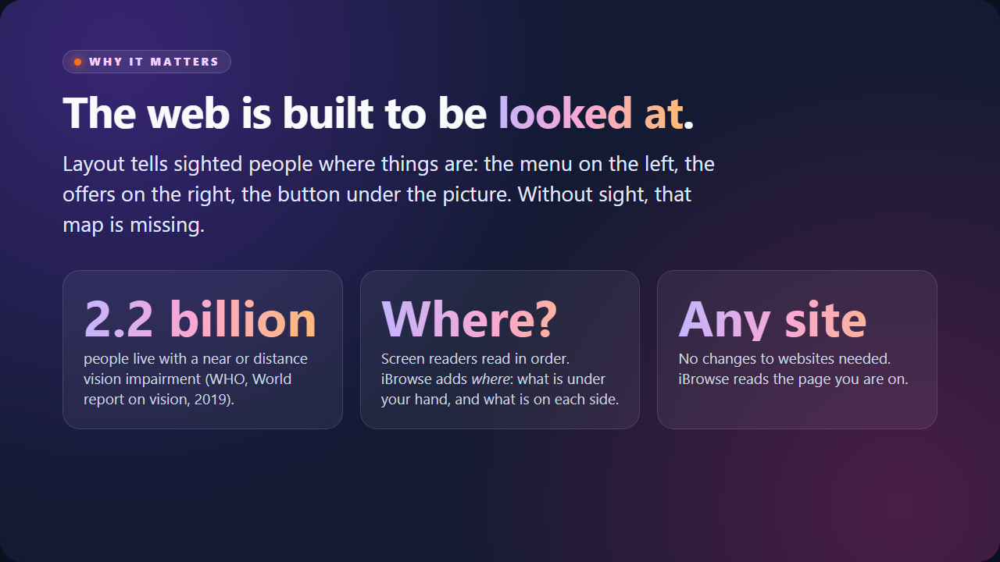

iBrowse is a **Chrome extension** (Manifest V3). Turn on **Explore Mode** and it tells you what the page holds, panel by panel: header, left, main, right, footer. Move a mouse or a finger and hear what is under it. Rest on something and it asks **"What would you like to do?"**. Answer out loud, or hold **Ctrl+Alt+V** and say *"click add to basket"*, *"scroll down"*, or *"what is on the left?"*.

It works on the websites you already use — no site changes required — and it runs on your computer.

| At a glance | |
|---|---|
| **Product** | Spatial audio + voice browser for blind / low-vision people |
| **Form factors** | Chrome / Edge / Brave extension · Mobile PWA · Docker / Node portal |
| **Speech** | Standalone Indian English (`en-IN`) or Companion mode (NVDA / JAWS / VoiceOver) |
| **Optional AI** | Your own Gemini key → Live voice, summaries, image describe; Claude fallback |
| **Privacy** | Local by default. Nothing leaves the device unless you opt in and are told aloud |
| **Status** | **v0.2.0** released · closed beta with blind testers next · Web Store planned |

---

## 🩷 Demo — see it and hear it

<div align="center">

<a href="docs/media/ibrowse-demo.mp4">
  
</a>

<sub>
  GIF is silent ·
  <a href="docs/media/ibrowse-demo.mp4"><b>MP4 has both voices</b></a> ·
  <a href="https://srksourabh.github.io/ibrowse/presentation/#slide-8">Presentation plays it with captions</a><br>
  In the recording, user commands are simulated and both voices are synthesised.
</sub>

</div>

---

## 🟠 How it works

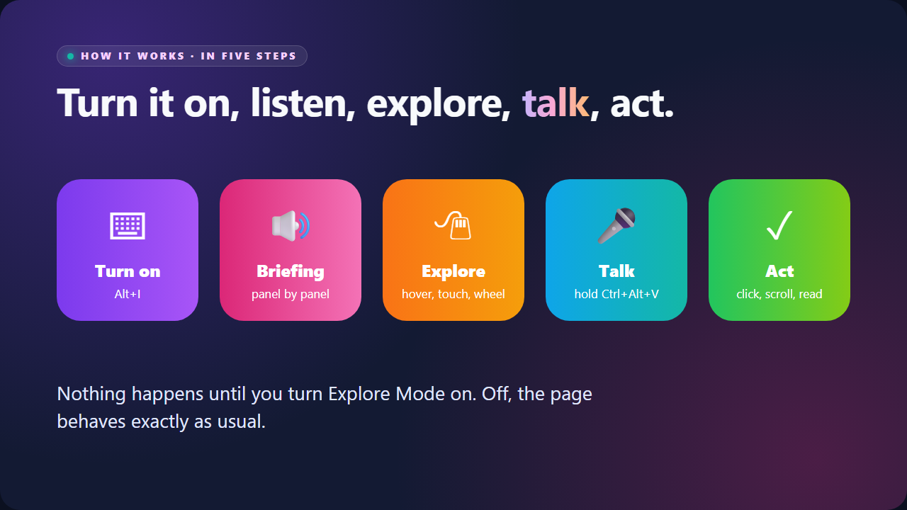

| | |
|---|---|
|  | 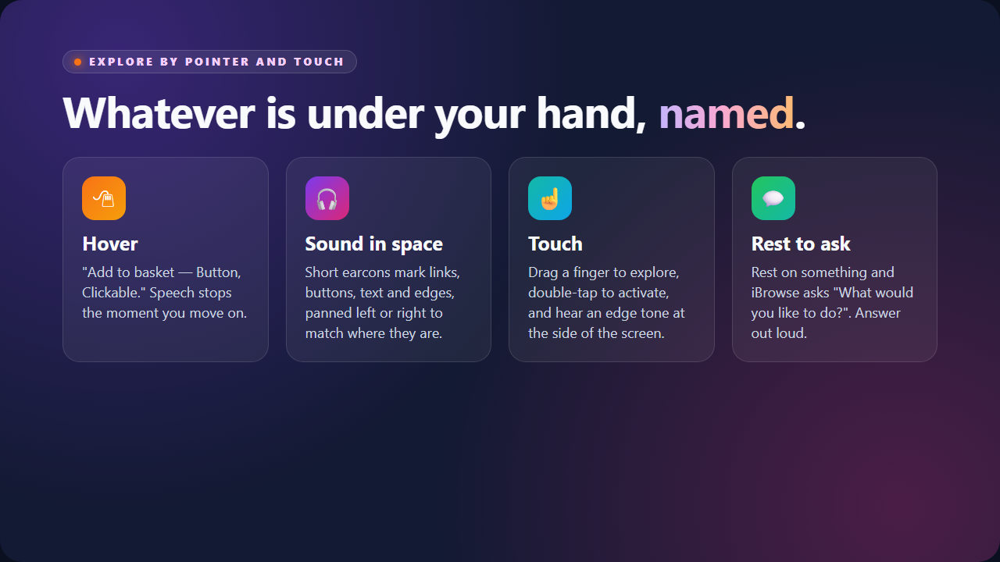 |
| **1 · Briefing** — landmarks or layout become a spoken 5-panel map. | **2 · Explore** — whatever is under your hand is named, with sound in space. |
| 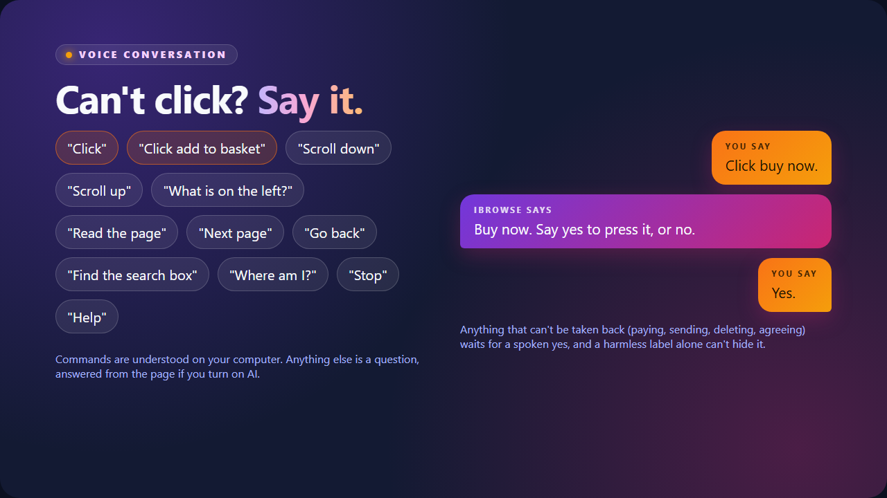 | 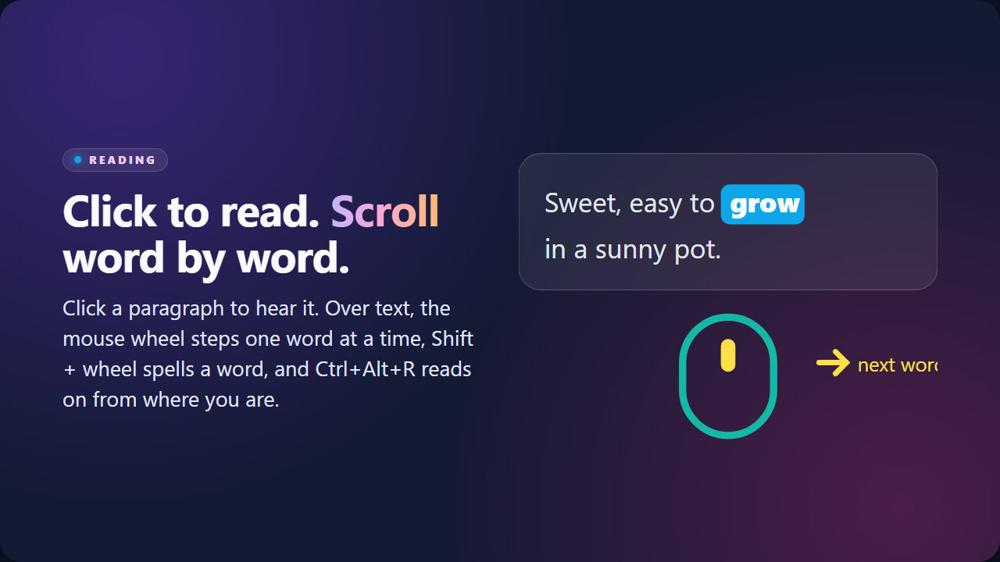 |
| **3 · Talk** — push-to-talk or answer after rest. Risky presses wait for *yes*. | **4 · Read** — click a paragraph; wheel steps words; Shift+wheel spells. |

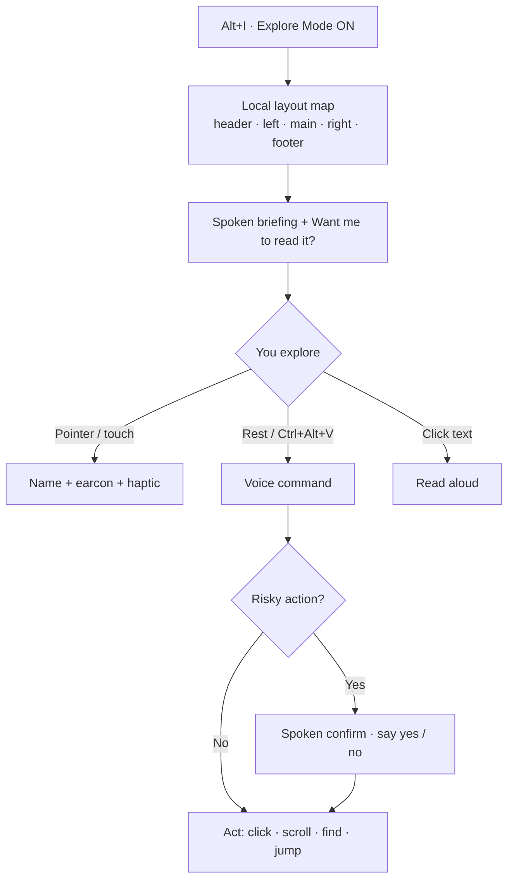

---

## 🟢 What you can do

| | Capability | What you hear / feel |
|---|---|---|
| 🗺️ | **Page briefing** | Header, left, main, right, footer — then *"Want me to read it?"* |
| 🖱️ | **Explore by pointer** | *"Add to basket — Button, Clickable."* Speech cancels as you move. Earcons panned L/R. |
| ☝️ | **Touch** | Drag to explore, double-tap to activate, edge tones at screen sides |
| 🎤 | **Voice** | *"Click"*, *"scroll down"*, *"what is on the left?"*, *"find the search box"* |
| 🛡️ | **Safe by voice** | Pay / send / delete / agree wait for a spoken **yes**. Never guesses. |
| 📖 | **Reading** | Click paragraph · wheel = words · Shift+wheel = spell |
| 🧭 | **Navigate** | Headings, landmarks, smart next/prev page |
| 📝 | **Forms & live** | Labels, typing echo, errors, dialogs, live regions. Passwords never spoken. |
| 🗣️ | **Companion mode** | NVDA / JAWS / VoiceOver speak for iBrowse — one voice |
| 🎮 | **Haptics** | Gamepad rumble or USB device via open [SDK](sdk/README.md) |
| ✨ | **Optional AI** | Gemini Live voice, summaries, image describe; Claude fallback |
| 🔒 | **Private by default** | No servers, accounts, or analytics unless you opt in |

Full list → **[docs/FEATURES.md](docs/FEATURES.md)**

<details>
<summary><b>Who it is for</b></summary>

| You are… | iBrowse gives you… |
|---|---|
| **Blind, using a screen reader** | Spatial *where*, beside your reader via Companion mode |
| **Blind, no screen reader** | Full standalone Indian English voice — install, tour, settings, hardware all speak |
| **Low vision** | Audio under the pointer + whole-page briefing |
| **Hardware maker** | Open [haptics SDK](sdk/README.md): JSON profiles + drivers |
| **Researcher / teacher** | Open, tested reference for hover, touch, voice, haptics |
| **Developer** | MV3 codebase with ADRs, phase plans, and agent skills |

Not a full screen-reader replacement, and not a medical device. See [USAGE_POLICY.md](USAGE_POLICY.md).

</details>

---

## 🌐 Platforms

| Platform | How you run it | Notes |
|---|---|---|
| **Windows / macOS** | Chrome · Edge · Brave extension | Primary product. [Download zip](https://github.com/srksourabh/ibrowse/releases/download/v0.2.0/ibrowse-0.2.0-chrome.zip) |
| **iPhone / iPad** | Safari → [PWA](https://srksourabh.github.io/ibrowse/demo/) → Add to Home Screen | Touch + voice demo surface |
| **Android** | Chrome PWA, or Kiwi / Mises load the extension zip | Full extension needs a Chromium browser that allows unpacked / zip extensions |
| **Self-host** | Docker or `npm start` portal | Download page, PWA, presentation, `/health` |
| **Windows native** | [`apps/windows`](apps/windows/README.md) | Early preview — not yet SR-tested |
| **iOS native** | [`apps/ios`](apps/ios/README.md) | Plan only |

Portal: **[srksourabh.github.io/ibrowse](https://srksourabh.github.io/ibrowse/)**

---

## 🚀 Install & use

### 1 · Desktop extension (v0.2.0)

1. **[Download `ibrowse-0.2.0-chrome.zip`](https://github.com/srksourabh/ibrowse/releases/download/v0.2.0/ibrowse-0.2.0-chrome.zip)** ([release notes](https://github.com/srksourabh/ibrowse/releases/tag/v0.2.0)).
2. Unzip to a permanent folder (e.g. `C:\iBrowse` or `~/iBrowse`).
3. Open `chrome://extensions` (or `edge://` / `brave://`).
4. Turn on **Developer mode** → **Load unpacked** → select the folder.
5. First run asks *"Do you use a screen reader?"* — **`Y`** Companion · **`N`** Standalone `en-IN`.

Build from source (Node 20+):

```bash
git clone https://github.com/srksourabh/ibrowse.git
cd ibrowse
npm install
npm run build
# Load unpacked: .output/chrome-mv3
```

### 2 · Mobile PWA

1. Open **[https://srksourabh.github.io/ibrowse/demo/](https://srksourabh.github.io/ibrowse/demo/)** in Safari (iOS) or Chrome (Android).
2. **Share → Add to Home Screen** (iOS) or **Menu → Add to Home Screen** (Android).
3. Tap **Initialize Audio & Haptics**, drag to explore, or tap **🎤 Speak**.

### 3 · Self-hosted server

```bash
# Docker
docker build -t ibrowse .
docker run -p 3000:3000 ibrowse

# Node 20+
npm ci && npm run build && npx wxt zip
PORT=3000 npm start
```

Serves `/` (portal), `/demo/`, `/presentation/`, zip download, and `/health`.

### Quick start (once installed)

| Step | Do this |
|---|---|
| 1 | **Alt+I** (or toolbar button) → Explore Mode on |
| 2 | Listen to the briefing → **Y** read / **N** skip |
| 3 | Move mouse or finger → hear what is under it |
| 4 | Click a paragraph to read · wheel steps words |
| 5 | **Alt+O** settings · **Ctrl+Alt+P** hardware |
| 6 | Optional: enable voice → hold **Ctrl+Alt+V** and speak |

<details>
<summary><b>⌨️ Keyboard & mouse cheatsheet</b></summary>

| Do this | Keys |
|---|---|
| Explore Mode on/off | **Alt+I** · toolbar · **Ctrl+Alt+E** off |
| Answer read prompt | **Y** / Enter · **N** / Esc |
| Read paragraph | Click it |
| Word by word | Wheel over text · **Shift+wheel** spells |
| Scroll page | **Alt+wheel** |
| Next / prev page | **Ctrl+Alt+Right / Left** · side buttons · context menu |
| Next / prev heading | **Ctrl+Alt+Down / Up** |
| Next / prev landmark | **Ctrl+Alt+PageDown / PageUp** |
| Where am I | **Ctrl+Alt+W** · or pointer at top edge |
| Detailed briefing / read from here | **Ctrl+Alt+B** / **Ctrl+Alt+R** |
| Describe image / summarise page | **Ctrl+Alt+D** / **Ctrl+Alt+M** (Gemini) |
| Settings / hardware | **Alt+O** · **Ctrl+Alt+P** |
| Stop speaking | **Esc** |
| Push-to-talk | Hold **Ctrl+Alt+V** |

In-page shortcuts can switch to `Alt+Shift` in settings. Remap everything at `chrome://extensions/shortcuts`.

</details>

<details>
<summary><b>🎤 Voice commands</b></summary>

| Say | It does |
|---|---|
| *"click"*, *"press it"* | Presses what the pointer is on (or reads text) |
| *"click sign in"* | Presses the named control |
| *"scroll down / up"*, *"go to the top"* | Scrolls, then describes the viewport |
| *"read this"*, *"read the page"* | Reads aloud |
| *"next page"*, *"go back"* | Navigates; Explore Mode stays on |
| *"what is on the left"*, *"go to the main content"* | Describes or moves to a panel |
| *"find the search box"*, *"where is the login"* | Moves there and names it |
| *"stop"*, *"repeat"*, *"where am I"*, *"help"* | Just that |
| Anything else | Page question → AI if enabled |

Listens only while you hold the key, or for ~5 s after it asks. Chrome may use on-device recognition or Google's cloud for that step.

</details>

<details>
<summary><b>🖼 Screenshots — settings, hardware, tour</b></summary>

| Settings | Hardware setup | First-run tour |
|---|---|---|
|  |  | 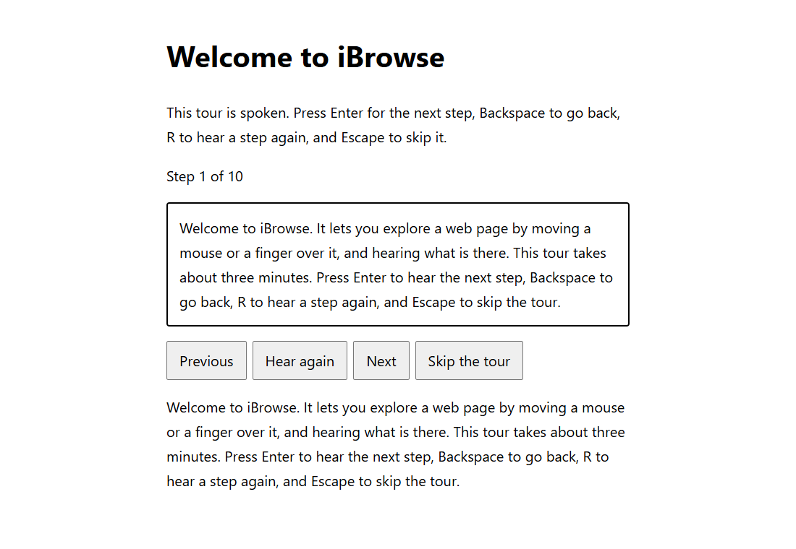 |

Every iBrowse page is keyboard-operable and spoken aloud.

</details>

More platforms & lab setup → **[docs/USER_GUIDE.md](docs/USER_GUIDE.md)**

---

## 🩵 Privacy in one paragraph

Everything runs on your device. Nothing is sent unless you turn on a Google Gemini feature, enter **your own** key, and allow the browser permission. Form values and passwords are never collected. Keys live where web pages cannot reach them. → [PRIVACY.md](PRIVACY.md)

---

## 🧰 Tech stack

| Layer | Choice | Why |
|---|---|---|
| **Extension host** | Chrome Manifest V3 · Edge · Brave | Reach any site with zero site changes ([ADR-0001](docs/adr/0001-chrome-extension-not-native.md)) |
| **Language** | TypeScript (strict) | Safety across content script + service worker |
| **Tooling** | [WXT](https://wxt.dev) · Vitest · Playwright · esbuild | Fast MV3 DX, unit + real-Chromium e2e |
| **A11y names** | [`dom-accessibility-api`](https://github.com/eps1lon/dom-accessibility-api) + WPT suite | Official accessible-name rules |
| **Speech (local)** | `chrome.tts` `en-IN` · Companion ARIA live regions | Zero-latency / one-voice with NVDA |
| **Speech (cloud)** | Gemini Live WebSocket → REST TTS + LRU cache | Natural voice with offline-friendly fallback |
| **AI Q&A / vision** | Gemini · Anthropic Claude Haiku fallback | Summaries, image describe, spoken Q&A |
| **Audio UX** | Web Audio earcons (stereo pan) | *Where* as sound |
| **Haptics** | Gamepad rumble · WebHID · JSON Device Profiles | Open [sdk/](sdk/README.md) |
| **Mobile** | Progressive Web App (`docs/demo/`) | Touch + voice without store wait |
| **Server portal** | Node `scripts/serve.mjs` · Docker · Railway schema | Zip + demo + presentation + health |
| **Native (preview)** | .NET Windows app · iOS plan | Future parity paths |

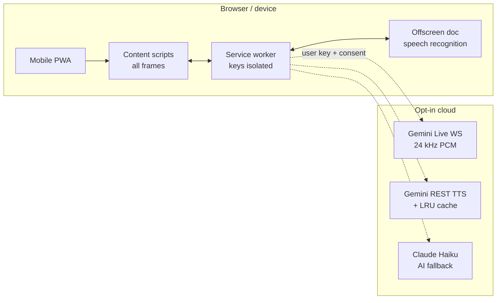

---

## 🏗 Architecture

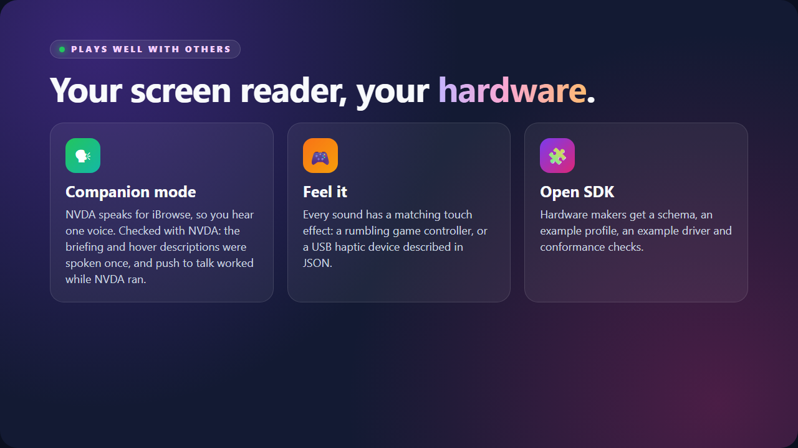

### Method (local first)

1. **Spatial layout mapping (< 1 s)** — DOM + ARIA landmarks + geometry → 5-panel map.
2. **Low-latency explore** — `elementsFromPoint` (shadow + iframes) → W3C name → cancel speech → panned earcon → haptic.
3. **3-tier `en-IN` voice** — Gemini Live → REST TTS cache → OS / Companion.
4. **Resilient AI** — Gemini with Claude fallback; page text fenced as untrusted data; keys only in the worker.
5. **Safe conversation** — on-device grammar + VAD; spoken confirm before irreversible actions.

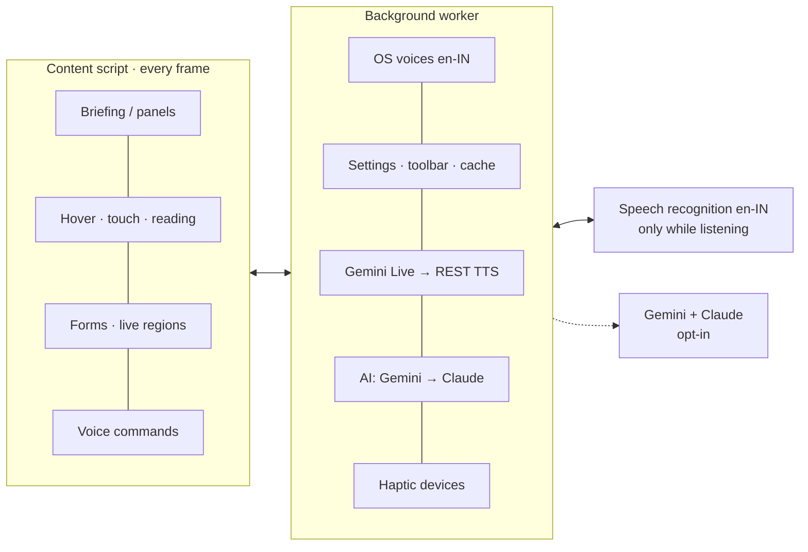

| Path | Holds |
|---|---|
| `entrypoints/`, `src/` | Extension (TypeScript, WXT) |
| `tests/`, `e2e/` | Vitest unit · Playwright e2e · `e2e/live/` real mic / NVDA |
| `sdk/` | Haptics schema + examples |
| `docs/presentation/` | HTML + PDF deck |
| `docs/adr/`, `docs/phases/` | Decisions and phase plans |
| `docs/store/` | Chrome Web Store listing assets |
| `apps/windows/`, `apps/ios/` | Native preview / plan |
| `.claude/skills/ibrowse-contributor/` | Agent skill for contributors |
| `demo/` | Legacy simulator (not the product) |

---

## ✅ Quality

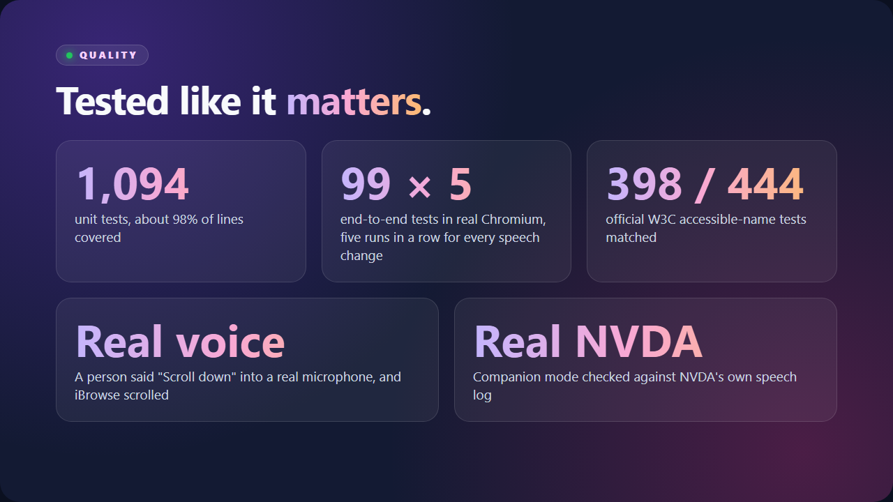

| Check | Bar |
|---|---|
| Unit tests | **1144** (Vitest + coverage) |
| End-to-end | **105** Playwright runs on real Chromium |
| Accessible names | Matched against official WPT suite |
| Speech races | Fixes must survive **5** clean e2e runs in a row |
| Screen readers | Verified with real **NVDA** |
| CI | Linux verify + e2e · Windows .NET build |

---

## 🛠 Develop

Requires **Node 20+**.

```bash
npm install
npm run dev           # Chrome with extension loaded
npm run typecheck
npm test              # unit + coverage
npm run build         # → .output/chrome-mv3
npm run test:e2e      # needs a build first
npm run screenshots   # refresh docs/images
npm run store-assets  # Web Store images
npm run icons         # render public/icon from scripts/icon.svg
```

Demo video & deck art come from the real extension: `e2e/media/demo-video.spec.ts`, `scripts/media/make-demo.mjs`, `scripts/media/export-deck.mjs`.

---

## 🧭 History & roadmap

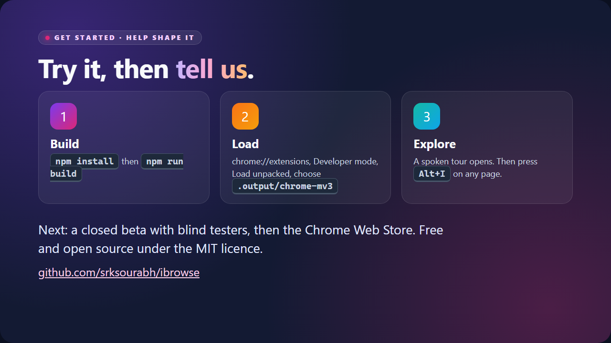

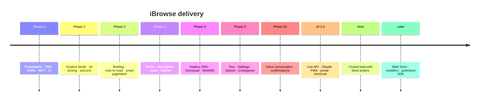

| Milestone | Outcome | State |
|---|---|---|
| Phase 0 — Foundations | PRD, glossary, ADRs, stack, earcons | Done |
| Phase 1 — Core exploration | Explore Mode, names, earcons, cancel | Done |
| Phase 2 — Intelligence | Briefing, read prompt, wheel scrub, pagination | Done |
| Phase 3 — Operation | Jumps, forms, live, iframes, touch | Done |
| Phase 4 — Hardware & SDK | Drivers, profiles, pairing, `sdk/` | Done |
| Phase 5 — Onboarding & AI | Tour, settings, Companion, Gemini | Done |
| Phase 5b — Voice conversation | Ask-after-rest, PTT, confirmations | Done |
| **v0.2.0 — Production MVP** | Live API, Claude, PWA, Docker portal, new shortcuts | **Released** |
| Phase 6 — Closed beta | Blind testers, real hardware, VoiceOver, noise | Next |
| Phase 7 — Public launch | Web Store, installers, npm SDK | Planned |

Plans → [docs/phases](docs/phases) · Decisions → [docs/adr](docs/adr)

---

## 📚 Docs & research

| Resource | What it is |
|---|---|
| **[Research & Recognition Pack](https://files.instinct.com/0si87vjp5vav-ibrowse-research-and-recognition-pack)** | Background research & recognition materials |
| [docs/USER_GUIDE.md](docs/USER_GUIDE.md) | Install & use — Windows, macOS, mobile, lab, server |
| [docs/FEATURES.md](docs/FEATURES.md) | Complete capability list |
| [Presentation](https://srksourabh.github.io/ibrowse/presentation/) · [PDF](docs/presentation/iBrowse-presentation.pdf) | 13-slide walkthrough |
| [Mobile PWA](https://srksourabh.github.io/ibrowse/demo/) | Try touch + voice in the browser |
| [PRD.md](PRD.md) | Requirements & milestones |
| [CONTEXT.md](CONTEXT.md) | Shared vocabulary (code, tests, speech) |
| [CLAUDE.md](CLAUDE.md) | Agent / contributor working rules |
| [CONTRIBUTING.md](CONTRIBUTING.md) · [CODE_OF_CONDUCT.md](CODE_OF_CONDUCT.md) | How to help |
| [SECURITY.md](SECURITY.md) · [PRIVACY.md](PRIVACY.md) · [USAGE_POLICY.md](USAGE_POLICY.md) | Trust & limits |
| [ACCESSIBILITY.md](ACCESSIBILITY.md) · [SUPPORT.md](SUPPORT.md) | A11y commitments & help |
| [CHANGELOG.md](CHANGELOG.md) | Release history |
| [sdk/README.md](sdk/README.md) | Haptics SDK |

---

<div align="center">

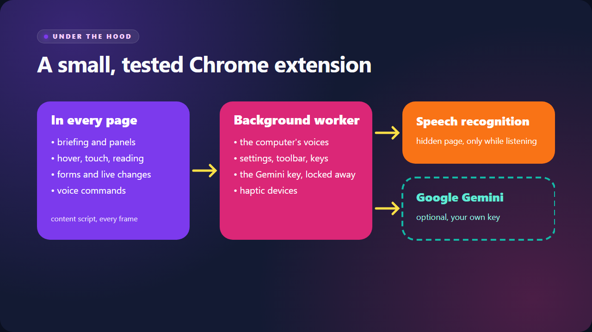

<br>

**Built for people who explore the web by ear.**

Contributions, testing and feedback welcome — see [CONTRIBUTING.md](CONTRIBUTING.md).

[MIT](LICENSE) · Copyright (c) 2026 iBrowse contributors

<br>

<sub>
  <a href="https://github.com/srksourabh/ibrowse/releases/download/v0.2.0/ibrowse-0.2.0-chrome.zip">Download</a> ·
  <a href="docs/media/ibrowse-demo.mp4">Demo</a> ·
  <a href="https://srksourabh.github.io/ibrowse/">Portal</a> ·
  <a href="https://srksourabh.github.io/ibrowse/presentation/">Presentation</a> ·
  <a href="https://srksourabh.github.io/ibrowse/demo/">PWA</a>
</sub>

</div>
