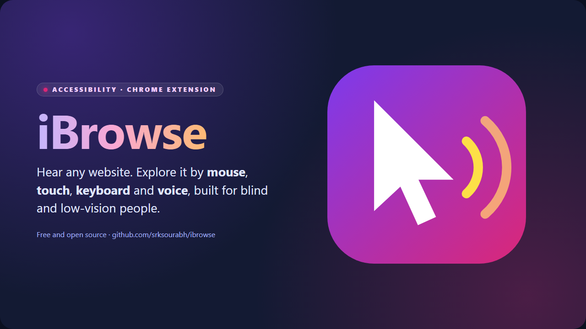
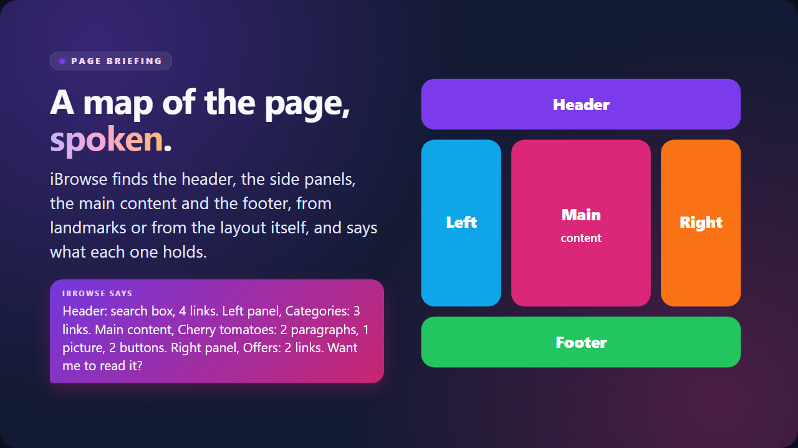
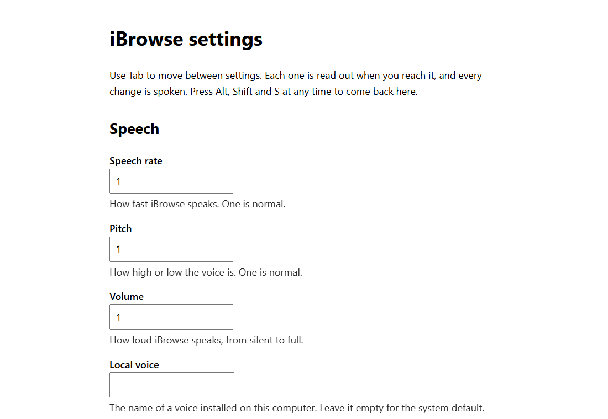
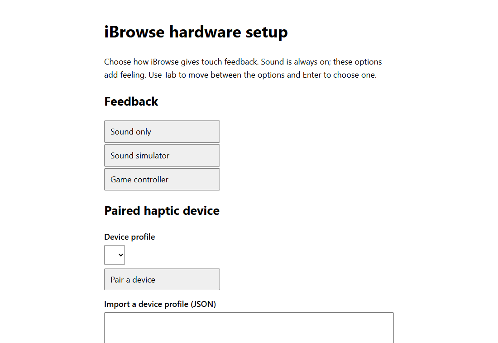
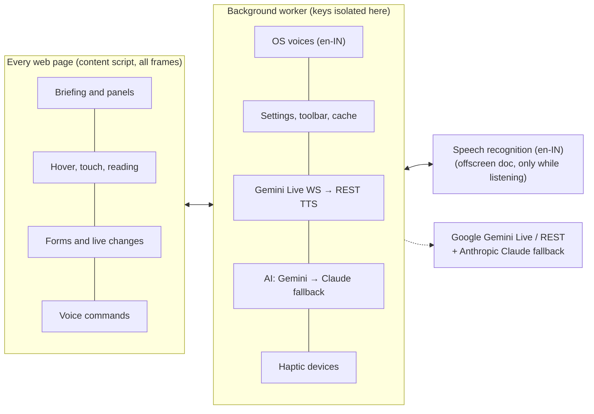

<div align="center">



<h3>Hear any website. Explore it by mouse, touch, keyboard and voice.</h3>

[](https://github.com/srksourabh/ibrowse/actions/workflows/ci.yml)


**[⬇ Download v0.2.0 (.zip)](https://github.com/srksourabh/ibrowse/releases/download/v0.2.0/ibrowse-0.2.0-chrome.zip)** · **[📱 Mobile & Web App](https://srksourabh.github.io/ibrowse/demo/)** · **[📖 User Guide](docs/USER_GUIDE.md)** · **[📚 Research & Recognition Pack](https://files.instinct.com/0si87vjp5vav-ibrowse-research-and-recognition-pack)** · **[See the presentation](https://srksourabh.github.io/ibrowse/presentation/)** ([PDF](docs/presentation/iBrowse-presentation.pdf)) · **[Every feature](docs/FEATURES.md)**

</div>

<br>

<sup><b>🟣 WHAT IT IS</b></sup>

## A map of any website, spoken

iBrowse is a Chrome extension for blind and low-vision people. Turn on **Explore Mode** and it tells you what the page holds, panel by panel: the header, the left panel, the main content, the right panel and the footer. Move a mouse or a finger and hear what is under it. Rest on something and it asks **"What would you like to do?"**. Answer out loud, or hold **Ctrl+Alt+V** and say "click add to basket", "scroll down" or "what is on the left?".

It works on the websites you already use, with no changes to them, and it runs on your computer.

<sup><b>🩷 SEE IT · AND HEAR IT</b></sup>

## The demo

<div align="center">

<a href="docs/media/ibrowse-demo.mp4"></a>

<sub>The GIF is silent. <a href="docs/media/ibrowse-demo.mp4">The MP4 has both voices</a>, and <a href="https://srksourabh.github.io/ibrowse/presentation/#slide-8">the presentation plays it with captions</a>. In the recording, the user's voice commands are simulated and both voices are synthesised.</sub>

</div>

<sup><b>🟠 HOW IT WORKS</b></sup>

## Turn it on, listen, explore, talk, act


| | |
|---|---|
|  |  |
| **Page briefing.** Landmarks or the layout itself become a spoken map. | **Voice.** Say a command, or ask a question. Risky presses wait for a spoken yes. |

<sup><b>🟢 WHAT YOU CAN DO</b></sup>

## Features

| | |
|---|---|
| 🗺️ **Page briefing** | Header, left panel, main content, right panel and footer, then "Want me to read it?" |
| 🖱️ **Explore by pointer** | "Add to basket — Button, Clickable." Speech stops the moment you move on. Earcons are panned left or right to where things are. |
| 🎤 **Talk to it** | Hold Ctrl+Alt+V, or answer when it asks. "Click", "click sign in", "scroll down", "what is on the left?", "find the search box", "go back". |
| 🛡️ **Safe by voice** | Paying, sending, deleting or agreeing waits for a spoken yes. It never guesses what to press. |
| 📖 **Reading** | Click a paragraph to hear it. The wheel steps word by word, and Shift + wheel spells a word. |
| 🧭 **Moving around** | Jump by heading or landmark. A smart next page follows "Next" links or scrolls. |
| 📝 **Forms and live changes** | Fields, typing echo, errors, dialogs and live updates are spoken. Passwords are never spoken. |
| ☝️ **Touch** | Drag to explore, double-tap to activate, edge tones at the sides of the screen. |
| 🗣️ **Screen reader friendly** | In Companion mode NVDA speaks for iBrowse, so you hear one voice. Checked with real NVDA. |
| 🎮 **Haptics** | A rumbling game controller, or a USB haptic device described in JSON, through an open [SDK](sdk/README.md). |
| ✨ **Optional AI** | With your own Google Gemini key: a natural voice, page summaries, image descriptions and answers to spoken questions. |
| 🔒 **Private by default** | No servers, no accounts, no analytics. Nothing is sent unless you turn a feature on and are told what is sent. |

The complete list is in **[docs/FEATURES.md](docs/FEATURES.md)**.

<sup><b>🔵 WHO IT IS FOR</b></sup>

## Who it is for

| You are… | iBrowse gives you… |
|---|---|
| **Blind, using a screen reader** | A spatial way to explore layout (where things are), beside your screen reader through Companion mode. |
| **Blind, with no screen reader** | A complete standalone voice. Install, tour, settings and hardware setup all speak. |
| **Low vision** | Audio descriptions of what is under the pointer, plus a briefing of the whole page. |
| **A haptic or accessibility hardware maker** | An open [SDK](sdk/README.md): describe a device in JSON, or contribute a driver. |
| **An accessibility researcher or teacher** | An open, tested reference for hover, touch, voice and haptic page exploration. |
| **A developer** | A well-documented MV3 codebase with decisions recorded as ADRs. |

It is **not** a replacement for a full screen reader, and is not a medical or safety device. See the [usage policy](USAGE_POLICY.md).

<sup><b>🟣 GET STARTED</b></sup>

## Install (v0.2.0)

### 1. Desktop Extension — Windows & macOS (Chrome, Edge, Brave)
1. **Download the latest release:** **[ibrowse-0.2.0-chrome.zip](https://github.com/srksourabh/ibrowse/releases/download/v0.2.0/ibrowse-0.2.0-chrome.zip)** ([Release notes](https://github.com/srksourabh/ibrowse/releases/tag/v0.2.0)).
2. **Unzip** it to a permanent folder (e.g. `C:\iBrowse` on Windows or `~/iBrowse` on macOS).
3. Open `chrome://extensions` (or `edge://extensions` / `brave://extensions`).
4. Turn on **Developer mode** (top right), click **Load unpacked**, and select the unzipped folder.
5. On first run, iBrowse asks **"Do you use a screen reader?"** — press **`Y`** for Companion mode (NVDA / JAWS / VoiceOver) or **`N`** for Standalone Indian English (`en-IN`) voice.

*(Or build from source with Node 20+: `git clone https://github.com/srksourabh/ibrowse.git && cd ibrowse && npm install && npm run build`, then load `.output/chrome-mv3`.)*

### 2. Mobile — iPhone, iPad & Android (PWA Web App)
1. Open **[https://srksourabh.github.io/ibrowse/demo/](https://srksourabh.github.io/ibrowse/demo/)** in Safari (iOS) or Chrome (Android).
2. Tap **Share → Add to Home Screen** (iOS) or **Menu → Add to Home Screen** (Android) to install it as a full-screen app.
3. Tap **Initialize Audio & Haptics**, drag your finger to explore by sound/vibration, or tap **🎤 Speak** for voice commands.

### 3. Self-Hosted Server (Docker or Node.js)
```bash
# Docker
docker build -t ibrowse .
docker run -p 3000:3000 ibrowse

# Or Node.js 20+
npm ci && npm run build && npx wxt zip
PORT=3000 npm start
```
Serves the download portal (`/`), mobile PWA (`/demo/`), presentation (`/presentation/`), zip download (`/download/ibrowse-0.2.0-chrome.zip`), and `/health`.

Full multi-platform & lab setup instructions: **[docs/USER_GUIDE.md](docs/USER_GUIDE.md)**.

## Quick start

1. Press **Alt+I** on a page, or click the iBrowse toolbar button, to turn on Explore Mode.
2. Listen to the briefing: the header, left panel, main content, right panel and footer, and what each holds. Press **Y** to have it read, or **N** to skip.
3. Move the mouse, or drag a finger, to hear what is under it. Click a paragraph to read it.
4. Press **Alt+O** (or **Ctrl+Alt+S** in Explore Mode) for settings and **Ctrl+Alt+P** for hardware.
5. Optional: turn on **Voice commands** in settings. Then hold **Ctrl+Alt+V** and speak, or answer when iBrowse asks "What would you like to do?" after you rest the pointer on something.

<details>
<summary><b>Keyboard and mouse</b></summary>

| Do this | Keys |
|---|---|
| Turn Explore Mode on or off | Alt+I, or the toolbar button (it shows ON while active); Ctrl+Alt+E turns it off |
| Answer the read question | Y or Enter / N or Esc |
| Read the clicked paragraph | Click it |
| Step through words | Scroll wheel over text (Shift+wheel spells the word) |
| Scroll the page | Alt+wheel |
| Next / previous page | Ctrl+Alt+Right / Left, side mouse buttons, or right-click menu |
| Next / previous heading | Ctrl+Alt+Down / Up |
| Next / previous landmark | Ctrl+Alt+PageDown / PageUp |
| Where am I (title, site, security, tab) | Ctrl+Alt+W, or move the pointer to the very top edge |
| Detailed briefing / read from here | Ctrl+Alt+B / Ctrl+Alt+R |
| Describe the image under the pointer | Ctrl+Alt+D (needs Gemini) |
| Summarise the page | Ctrl+Alt+M (needs Gemini) |
| Settings | Alt+O (or Ctrl+Alt+S while Explore Mode is on) |
| Hardware setup | Ctrl+Alt+P (or from Settings) |
| Stop speaking | Esc |
| Touch: explore / activate | Drag or tap / double-tap anywhere |
| Talk (voice commands on) | Hold Ctrl+Alt+V, speak, let go |

In-page shortcuts can be switched to `Alt+Shift` in settings, and every command can be remapped at `chrome://extensions/shortcuts`.

</details>

<details>
<summary><b>Voice commands</b></summary>

With voice commands on, say any of these while holding Ctrl+Alt+V, or as the answer when iBrowse asks what to do:

| Say | It does |
|---|---|
| "click", "press it" | Presses what the pointer is on (reads it, if it is text) |
| "click sign in" | Presses the control with that name |
| "scroll down", "scroll up", "go to the top" | Scrolls, then says what is on screen |
| "read this", "read the page" | Reads aloud |
| "next page", "go back" | Moves between pages; Explore Mode stays on |
| "what is on the left", "go to the main content" | Describes or moves to a panel |
| "find the search box", "where is the login" | Moves to it and says what it is |
| "stop", "repeat", "where am I", "help" | Just that |
| Anything else | A question about the page, answered by AI if it is on |

Chrome turns speech into text on your computer when it can, and otherwise sends it to Google for that. iBrowse listens only while you hold the key, or for five seconds after it asks you something.

</details>

<details>
<summary><b>Screenshots of the settings, hardware setup and tour</b></summary>

Every page of iBrowse works by keyboard and is spoken aloud. These are the pages you can see.

| Settings | Hardware setup | First-run tour |
|---|---|---|
|  |  |  |

</details>

<sup><b>🩵 PRIVATE BY DEFAULT</b></sup>

## Privacy in one paragraph

Everything runs on your device. Nothing is sent anywhere unless you turn on a Google Gemini feature, enter your own key, and allow the browser permission. Form values and passwords are never collected, and your key is kept where web pages cannot reach it. Full details: [PRIVACY.md](PRIVACY.md).

<sup><b>🟠 METHOD & ARCHITECTURE</b></sup>

## Method: how iBrowse turns any webpage into spatial sound

1. **Spatial layout mapping (local, < 1 s):** On entering Explore Mode, the content script inspects DOM structure, ARIA landmarks, and bounding-box geometry across all frames to build a 5-panel mental map (*header, left panel, main content, right panel, footer*).
2. **Low-latency pointer & touch exploration:** Every pointer move resolves the topmost meaningful target (`elementsFromPoint`, piercing open shadow roots and iframes), computes its W3C accessible name (`dom-accessibility-api`), cancels prior speech immediately, plays a stereo-panned Web Audio earcon, and fires a matching haptic event.
3. **3-tier Indian English (`en-IN`) voice pipeline:**
   - **Real-time cloud voice:** Persistent **Gemini Live API** WebSocket (`models/gemini-3.8-live`, 24 kHz PCM audio) with 140-character first-sentence fast-start and parallel chunk prefetching.
   - **Automatic REST fallback:** Falls back seamlessly to Gemini REST TTS (`gemini-3.8-flash-lite-tts`) with a 100-phrase LRU audio cache.
   - **Zero-latency local fallback:** OS voices via `chrome.tts` (`en-IN`), or Companion ARIA live regions for NVDA/JAWS/VoiceOver.
4. **Resilient AI Q&A & vision:** Optional page summaries, image descriptions, and spoken questions run through **Google Gemini** with automatic fallback to **Anthropic Claude** (`claude-haiku-4-5-20251001`). Page text is always fenced as untrusted data, and API keys live strictly in the background worker (never in page scripts).
5. **Fast `en-IN` voice conversation:** On-device command grammar with silence auto-stop (700 ms VAD) and mandatory spoken confirmation before irreversible actions (*buy, pay, delete, submit*).



| Path | What it holds |
|---|---|
| `entrypoints/`, `src/` | The Chrome extension (TypeScript, WXT) |
| `tests/`, `e2e/` | Unit tests (Vitest) and end-to-end tests (Playwright, real Chromium); `e2e/live/` holds checks with real speech, a real microphone and NVDA |
| `sdk/` | Haptics SDK: JSON schema, examples |
| `docs/presentation/` | The presentation (HTML and PDF) |
| `docs/adr/` | Architecture decisions and their reasons |
| `docs/phases/` | Plan and exit checklist for each phase |
| `docs/store/` | The Chrome Web Store listing |
| `apps/windows/` | iBrowse for Windows (.NET): **early preview**, core tested, not yet used with a screen reader |
| `apps/ios/` | iBrowse for iOS: **plan only**, not built |
| `.claude/skills/ibrowse-contributor/` | A skill that teaches an AI agent to work on this repo |
| `demo/` | The original browser simulator (not the product) |

<sup><b>🟢 QUALITY</b></sup>

## Tested like it matters


## Develop

Requires Node 20 or newer.

```
npm install
npm run dev           # opens Chrome with the extension loaded
npm run typecheck
npm test              # unit tests with coverage
npm run build         # output in .output/chrome-mv3
npm run test:e2e      # end-to-end, needs a build first
npm run screenshots   # refresh docs/images
npm run store-assets  # refresh the Web Store images
npm run icons         # render public/icon from scripts/icon.svg
```

The demo video and the presentation images are made from the real extension: see `e2e/media/demo-video.spec.ts`, `scripts/media/make-demo.mjs` and `scripts/media/export-deck.mjs`.

<sup><b>🧭 PROJECT HISTORY & MILESTONES</b></sup>

## History & status

iBrowse began as a native Windows accessibility simulator (`demo/`), pivoted to a cross-platform Chrome Manifest V3 extension ([ADR-0001](docs/adr/0001-chrome-extension-not-native.md)) to reach any website with zero setup, and evolved through seven test-driven phases into the v0.2.0 MVP:

| Milestone | Scope & Key Outcomes | State |
|---|---|---|
| **Phase 0 — Foundations** | PRD, domain glossary (`CONTEXT.md`), ADRs, WXT/TypeScript strict stack, CI, earcons, latency meter | Done |
| **Phase 1 — Core Exploration** | Explore Mode toggle, spatial hit testing, W3C accessible names, stereo-panned earcons, instant speech cancel | Done |
| **Phase 2 — Intelligence** | Local layout analyzer, page briefing + Read Prompt, click-to-read, word-by-word wheel scrubbing, smart next/prev page | Done |
| **Phase 3 — Operation** | Heading & landmark jumps, forms & typing echo (passwords never spoken), live regions/dialogs, cross-origin iframes, touch lift-to-activate | Done |
| **Phase 4 — Hardware & SDK** | `HapticDriver` contract, sound simulator, Gamepad & WebHID drivers, JSON Device Profiles, pairing page, open `sdk/` | Done |
| **Phase 5 — Onboarding, Settings & AI** | Spoken first-run tour, keyboard-only spoken Settings, Companion mode (NVDA), Gemini cloud voice & AI vision/summaries | Done |
| **Phase 5b — Voice Conversation** | 5-panel briefing, Ask After Rest, Push-to-Talk, on-device command grammar with risky-action confirmation, real-mic & NVDA verification | Done |
| **v0.2.0 — Production & Real-Time MVP** | `Alt+I`/`Alt+O`/`Ctrl+Alt` shortcuts ([ADR-0018](docs/adr/0018-shortcuts-away-from-alt-shift.md)), first-run screen reader prompt ([ADR-0019](docs/adr/0019-first-question-is-the-screen-reader.md)), Indian English (`en-IN`) voices, **Gemini Live API** WebSocket streaming, **Anthropic Claude** AI fallback, Mobile PWA (`docs/demo/`), Docker/Node server | **Released (`v0.2.0`)** |
| **Phase 6 — Closed Beta** | Blind tester study (accents, noisy rooms, real haptic hardware, VoiceOver, real touchscreens) | Next |
| **Phase 7 — Public Store Launch** | Chrome Web Store public listing, Windows/Mac installers ([ADR-0016](docs/adr/0016-desktop-installers-add-the-extension.md)), npm SDK release | Planned |

Full phase plans and architectural decisions live in [docs/phases](docs/phases) and [docs/adr](docs/adr).

## Documents & Research

| File / Link | What it holds |
|---|---|
| **[Research & Recognition Pack](https://files.instinct.com/0si87vjp5vav-ibrowse-research-and-recognition-pack)** | Background research, accessibility study, and recognition materials |
| [docs/USER_GUIDE.md](docs/USER_GUIDE.md) | Step-by-step installation & user guide (Windows, macOS, Mobile, Lab, Server) |
| [docs/FEATURES.md](docs/FEATURES.md) | Everything iBrowse can do, in one list |
| [Presentation](https://srksourabh.github.io/ibrowse/presentation/) ([PDF](docs/presentation/iBrowse-presentation.pdf)) | How iBrowse works, in 13 slides |
| [Mobile & Web App (PWA)](https://srksourabh.github.io/ibrowse/demo/) | Try iBrowse directly on iPhone, Android, or desktop browsers |
| [PRD.md](PRD.md) | Requirements, scope, milestones |
| [CONTEXT.md](CONTEXT.md) | Shared vocabulary used in code, tests and speech |
| [CLAUDE.md](CLAUDE.md) | Working rules for AI agents and contributors |
| [CONTRIBUTING.md](CONTRIBUTING.md) | How to help |
| [CODE_OF_CONDUCT.md](CODE_OF_CONDUCT.md) | Community standards |
| [SECURITY.md](SECURITY.md) | Reporting vulnerabilities |
| [PRIVACY.md](PRIVACY.md) | What is stored and sent |
| [USAGE_POLICY.md](USAGE_POLICY.md) | Acceptable use and honest limits |
| [ACCESSIBILITY.md](ACCESSIBILITY.md) | Our accessibility commitments |
| [SUPPORT.md](SUPPORT.md) | Where to get help |
| [CHANGELOG.md](CHANGELOG.md) | Full release history |

## Roadmap

Closed beta with blind testers, then a Chrome Web Store release and a published SDK. The Windows desktop explorer ([early preview](apps/windows/README.md)) grows toward parity with the extension, and desktop installers will add the extension with an On/Off switch. An iOS browser ([plan only](apps/ios/README.md)) needs a Mac to build.

<div align="center">

<br>

**Built for people who explore the web by ear.** Contributions, testing and feedback are welcome: see [CONTRIBUTING.md](CONTRIBUTING.md).

[MIT](LICENSE) · Copyright (c) 2026 iBrowse contributors

</div>
